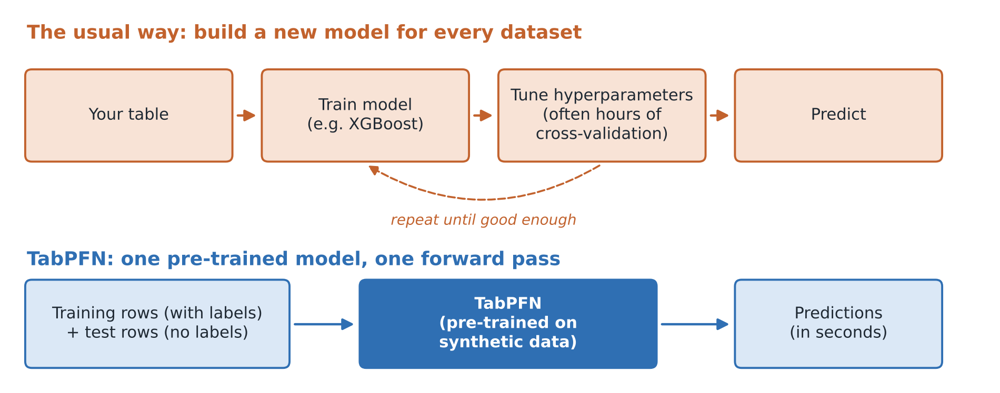
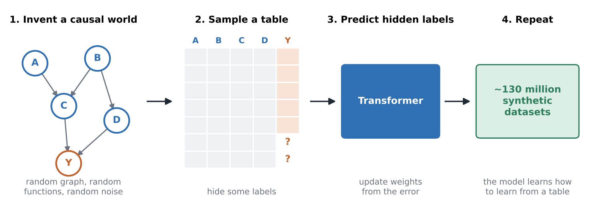
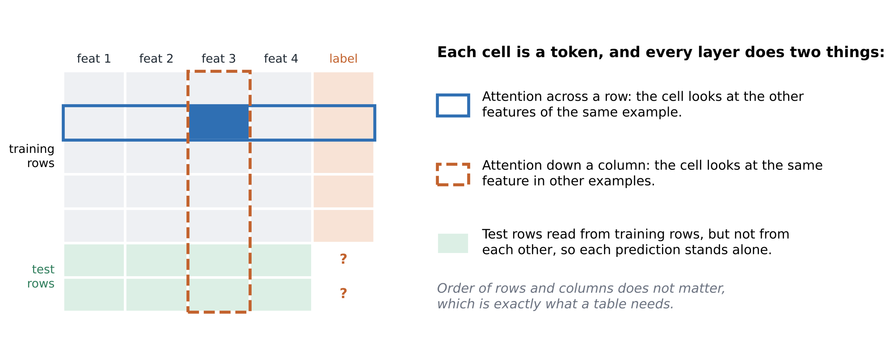
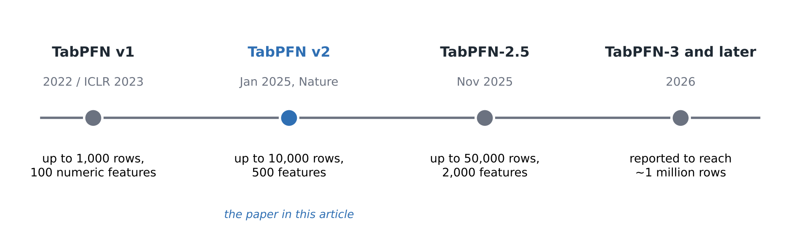

# No Training, No Tuning: How a Transformer Learned to Predict Any Table

An explainer on **TabPFN**, the tabular foundation model published in *Nature* in January 2025. It is a transformer pre-trained on about 130 million synthetic tables. On a new dataset it makes predictions in a single forward pass, with no training and no hyperparameter tuning.

**Headline result:** on classification datasets with up to 10,000 rows, TabPFN beat an ensemble of the strongest baselines tuned for 4 hours, and it took only 2.8 seconds.

## Links

| Resource | Link |
|---|---|
| ✍️ Medium article | [No Training, No Tuning: How a Transformer Learned to Predict Any Table](https://medium.com/@anshita.apps/no-training-no-tuning-how-a-transformer-learned-to-predict-any-table-1e6c19b382ed) |
| 🎥 Video walkthrough | [Watch on YouTube](https://youtu.be/iPIy0t37DPM) |
| 📊 Slides | [TabPFN_No_Training_No_Tuning.pptx](slides/TabPFN_No_Training_No_Tuning.pptx) |
| 📝 Video script | [TabPFN_Video_Script.pdf](script/TabPFN_Video_Script.pdf) |
| 📄 Paper | [Hollmann et al., *Nature* 637, 319–326 (2025)](https://doi.org/10.1038/s41586-024-08328-6) |

## What's covered

- **The problem.** Gradient-boosted trees (XGBoost, LightGBM, CatBoost) have been the default choice for tabular data for about 20 years.
- **The core idea.** Instead of training a new model for every dataset, TabPFN learns a learning algorithm once. This is in-context learning applied to tables.
- **Pre-training.** The model is trained on synthetic datasets generated from structural causal models, built from random graphs, random functions and random noise.
- **Architecture.** A 12-layer transformer treats every cell as a token and runs two-way attention, across rows and down columns.
- **Evaluation.** It was tested on the AutoML Benchmark and OpenML-CTR23: 29 classification and 28 regression datasets, scored with ROC AUC, accuracy, R² and RMSE against tuned baselines.
- **Beyond prediction.** The same model can do density estimation, generate synthetic data, impute missing values, produce embeddings and be fine-tuned.
- **What came next.** TabPFN-2.5 handles up to 50,000 rows and 2,000 features, and later versions push further.
- **Limitations.** Scale, inference cost, interpretability, mismatch with the synthetic training data, and licensing.
- **My take.** It removes the tuning loop, not the thinking.

## Figures

| | |
|---|---|
|  |  |
| *The usual workflow vs. one forward pass* | *Pre-training on synthetic causal worlds* |
|  |  |
| *Two-way attention across rows and columns* | *How TabPFN's size limits have grown* |

All figures are original illustrations based on the papers below.

## Repository structure

```
.
├── README.md
├── slides/
│   └── TabPFN_No_Training_No_Tuning.pptx   13 slides, speaker notes included
├── script/
│   └── TabPFN_Video_Script.pdf             narration for the video, with timestamps
└── figures/
    ├── fig1_pipeline.png
    ├── fig2_pretraining.png
    ├── fig3_attention.png
    └── fig4_timeline.png
```

## References

1. Hollmann, N., Müller, S., Purucker, L., Krishnakumar, A., Körfer, M., Hoo, S. B., Schirrmeister, R. T., and Hutter, F. (2025). Accurate predictions on small data with a tabular foundation model. *Nature*, 637(8045), 319–326. https://doi.org/10.1038/s41586-024-08328-6
2. Hollmann, N., Müller, S., Eggensperger, K., and Hutter, F. (2023). TabPFN: A transformer that solves small tabular classification problems in a second. *ICLR 2023*. https://arxiv.org/abs/2207.01848
3. Grinsztajn, L., Hutter, F., et al. (2025). TabPFN-2.5: Advancing the state of the art in tabular foundation models. https://arxiv.org/abs/2511.08667
4. TabPFN code: https://github.com/PriorLabs/TabPFN

---

**Anshita Shah** · MS Software Engineering, San José State University · [LinkedIn](https://www.linkedin.com/in/anshita-shah-9a83322b4) · [Medium](https://medium.com/@anshita.apps)
